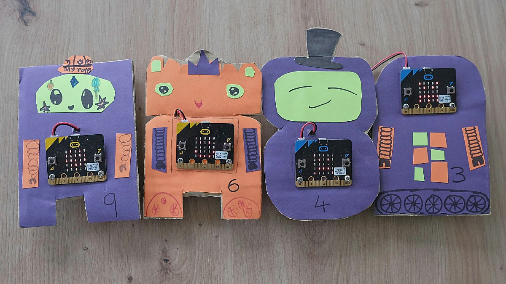
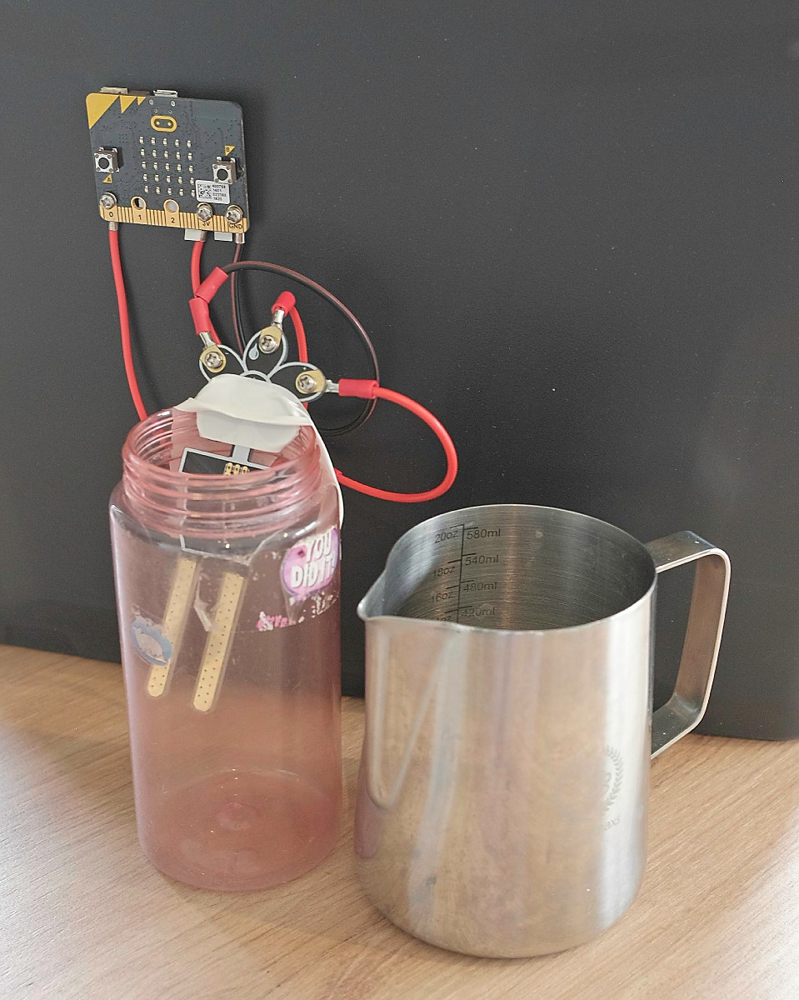
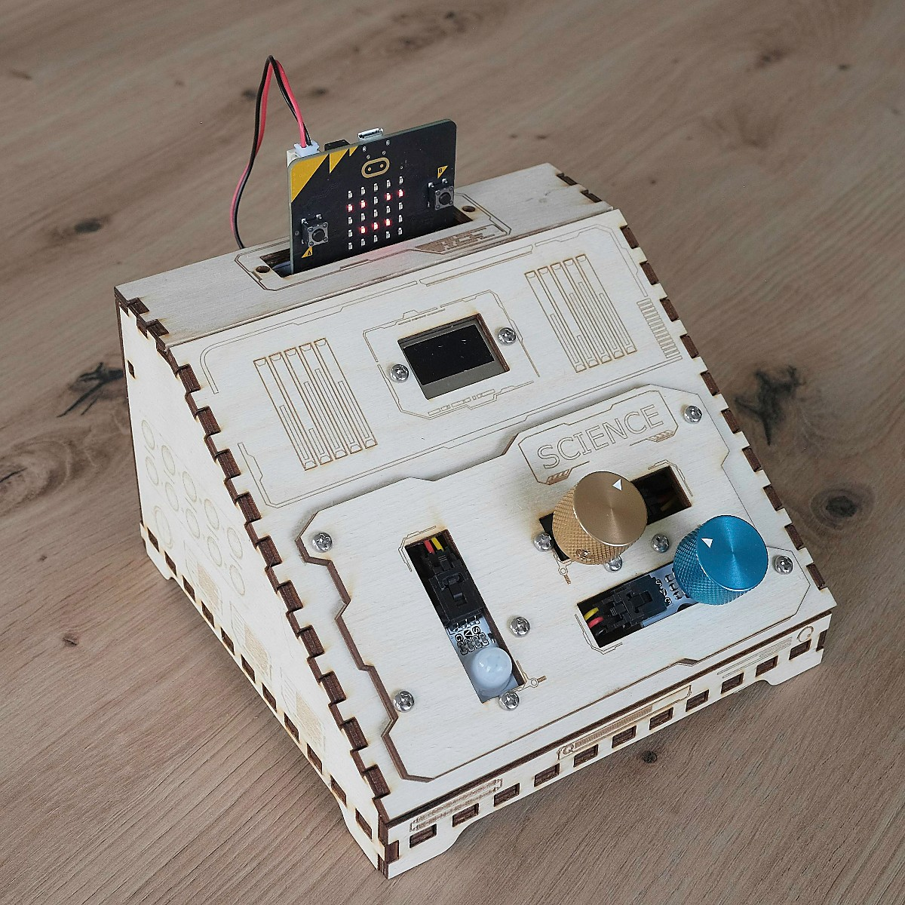
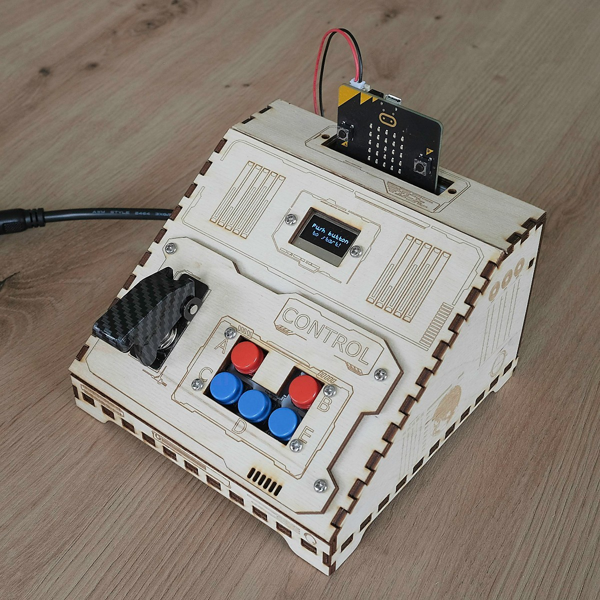

Fix the Space Ship is a short escape room activity, built from eight micro:bits, some laser cut boxes and a lot of craft materials.  Teams play the crew of a crashed spaceship, and have to work through a series of puzzles to refuel the ship, get the power back online, plot a course home and run through the launch sequence, all against the clock.

I built it for a Scouts and Guides camp, and have since run it at the [EMF Festival](https://www.emfcamp.org) too.  This video shows how it all works, and follows some of the teams as they play through it:

  <iframe
    width="100%"
    height="100%"
    src="https://www.youtube.com/embed/0pUaQZcnjMQ"
    title="I built a spaceship escape room using micro:bits!"
    frameborder="0"
    allow="accelerometer; autoplay; clipboard-write; encrypted-media; gyroscope; picture-in-picture"
    allowfullscreen
    class="absolute top-0 left-0 w-full h-full"></iframe>

Everything needed to build and run the activity - the code, the box designs, the manual and photos of each step - is in the [Fix the Space Ship repository on GitHub](https://github.com/brggs/Fix-The-SpaceShip-Escape-Room).  I hope it's useful either as inspiration for creating your own escape room, or for having a go at recreating this one for your own group.

## Who it's for

Teams of kids, roughly Cub and Brownie age upwards - it's been played by Cubs, Brownies, Scouts and Guides.  No coding is needed to play, the aim is to show kids what can be built with a micro:bit and some things from around the house, and to leave them wanting to make something themselves.

Adults have played it too and enjoyed it, although some of the puzzles are a little on the easy side for them.

It works well as one station at a camp or activity day, with teams taking it in turns and competing for the fastest time.  Running it for a whole camp kept me busy all day.

## How it works

The Control Computer shows the team their next task, along with how long they've taken so far.  The steps are described in more detail in the [Space Ship Manual](https://github.com/brggs/Fix-The-SpaceShip-Escape-Room/blob/main/Spaceship%20Challenge%20Manual.pdf), which each team is given at the start.

**Step 1 - Refill the fuel tank.**  Four robots each hold one digit of the code for the padlocked fuel store.  Each robot needs a different input - pressing both buttons, a shake, turning it upside down or covering it up to make it dark - before it will reveal a secret letter on its screen, and the letters give the order to read the digits in.  Once the store is unlocked, the team use a jug to fill the fuel tank to exactly the right level.  A moisture sensor in the tank drives a smiley face on the micro:bit above it, and overfilling means taking some back out.

**Step 2 - Charge the battery.**  The battery is a Pringles tube with a micro:bit in the lid.  Its accelerometer counts movement, so the team charge it by running around with it until the display shows a tick.

**Step 3 - Set a course for Space HQ.**  The Science Computer wakes up and shows sensor readings for climate, atmosphere and temperature.  The team compare these to a table of planets in the manual to work out where they've crashed, then use the map to find the direction and distance to Space HQ and dial them in with the two knobs.

**Step 4 - Send a message.**  The team shout a message to Space HQ into the Science Computer's microphone until the meter on the screen fills up.

**Step 5 - Launch sequence.**  The team press the big red button, and both consoles start showing a frantic series of instructions: press this button, flick that switch, turn the gold dial, stand still.  The buttons for each instruction are often on the other console, so the team have to read the instructions out loud and work together.  One last press of the big red button stops the clock, and their time is shown on the Control Computer.

The micro:bits keep in sync using the micro:bit's built in radio, so there are no wires between the steps apart from the cable from the big red button to the Control console.

## What you'll need

The full [parts list](https://github.com/brggs/Fix-The-SpaceShip-Escape-Room/blob/main/parts.md) is in the repository, and each step's build guide lists the parts for just that step.  In summary:

- 8 micro:bits with battery packs.  The two consoles need v2 micro:bits, for the microphone and the extra memory.  The other six can be v1 or v2.
- Two [ELECFREAKS micro:bit Tinker Kits](https://shop.elecfreaks.com/products/elecfreaks-micro-bit-tinker-kit-without-micro-bit-board), or the equivalent parts: two Octopus:bit breakout boards, two OLED screens, an ADKeyPad, a PIR sensor, two rotation dials and a soil moisture sensor.  I picked the kits up for around £20.
- A [big red arcade button](https://shop.pimoroni.com/products/massive-arcade-button-with-led-100mm-red?variant=8310528641) and a covered flick switch.
- Card, tape and a Pringles tube for the robots and the battery.
- A lockable container and padlock, a jug, and a wide-necked bottle for the fuel tank.
- Access to a laser cutter for the consoles.  Plywood works well, but they could be made from cardboard instead.
- A printed copy of the manual for each team, a table, and something to write down the teams' times on.

## Building it

Each step in the repository has its own read me with photos, an equipment list, build instructions and how to reset it between teams:

- [Robots](https://github.com/brggs/Fix-The-SpaceShip-Escape-Room/blob/main/src/step-1a/README.md) and [refuelling](https://github.com/brggs/Fix-The-SpaceShip-Escape-Room/blob/main/src/step-1b/README.md)
- [Battery](https://github.com/brggs/Fix-The-SpaceShip-Escape-Room/blob/main/src/step-2/README.md)
- [Science Unit](https://github.com/brggs/Fix-The-SpaceShip-Escape-Room/blob/main/src/science/README.md), which handles steps 3 and 4 and half of the launch sequence
- [Control Unit](https://github.com/brggs/Fix-The-SpaceShip-Escape-Room/blob/main/src/control/README.md), the brains of the room, which runs the clock and the other half of the launch sequence

The code is written in Python, and is loaded onto the micro:bits with the [micro:bit Python editor](https://python.microbit.org/v/3).  The laser cutter files for the consoles are in the repository's [box designs folder](https://github.com/brggs/Fix-The-SpaceShip-Escape-Room/tree/main/assets/box_src).

If you want to change the story or the puzzles, the manual is also available as an [editable Google Doc](https://docs.google.com/document/d/1UZmQcw_lCy3J1W7tHfdochccHPePtWkxOZ1arFSAfAo/edit?usp=sharing).

The robots make a good stand alone activity on their own, and kids can build their own from a micro:bit and some card by following the [Code and Craft Puzzle Robots](/articles/code-and-craft-puzzle-robot) tutorial.  For a wider look at designing escape room puzzles with kids, see [Build your own escape room puzzle with the micro:bit](/articles/build-your-own-escape-room-puzzle).

## Running the session

1. Set the room up before the first team arrives.  Lock the jug in the fuel store, empty the fuel tank, check the flick switch is off, then turn all the micro:bits on.  Hide the robots around the area if you have space.
2. Give the team the manual, and let them press the big red button to start.
3. Stay close by.  Teams will need the odd nudge, and it's worth watching the fuel step so no-one tips the store over.
4. When the clock stops, write the team's time down before you reset anything.  A whiteboard leaderboard adds some healthy competition between teams.
5. To reset, empty the fuel tank, put the jug back in the fuel store and lock it, turn the flick switch off, then restart the micro:bits.

Two tips from running it:

- Flash a spare micro:bit with the [override code](https://github.com/brggs/Fix-The-SpaceShip-Escape-Room/blob/main/src/override/README.md) and keep it in your pocket.  It can resend any of the radio messages, so if one gets missed you can nudge the game along without the team noticing.
- The PIR sensor used for the "stand still" instruction can be a bit over sensitive.  Covering it with your hand works, or take that instruction out of the code.

## Credits and licence

Thanks to [brainthee](https://github.com/brainthee) for designing the console boxes and helping with the construction, and to the Strategy and Evolution Scout camps for having me along.

The designs, code and documentation are released under the [Creative Commons Attribution 4.0](https://creativecommons.org/licenses/by/4.0/legalcode) licence, so please do use them, adapt them and make your own version.  If you do, include a credit to [Curious Coders](https://curiouscoders.co.uk), and do let me know how you get on!
