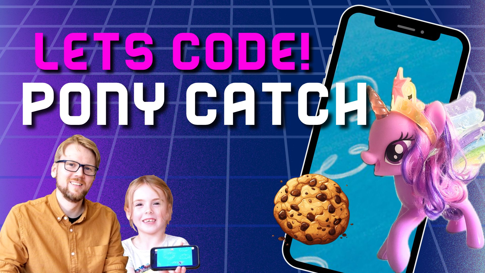
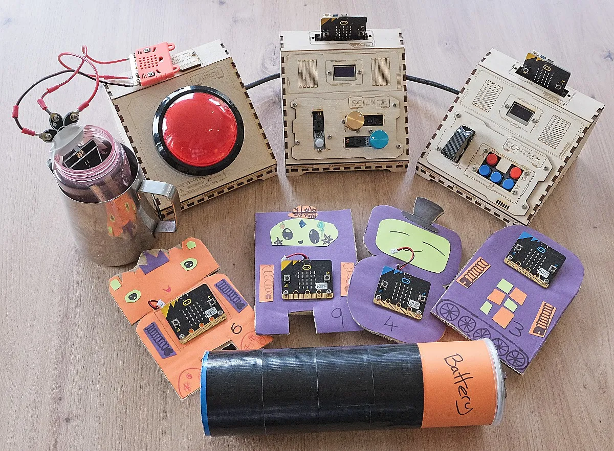
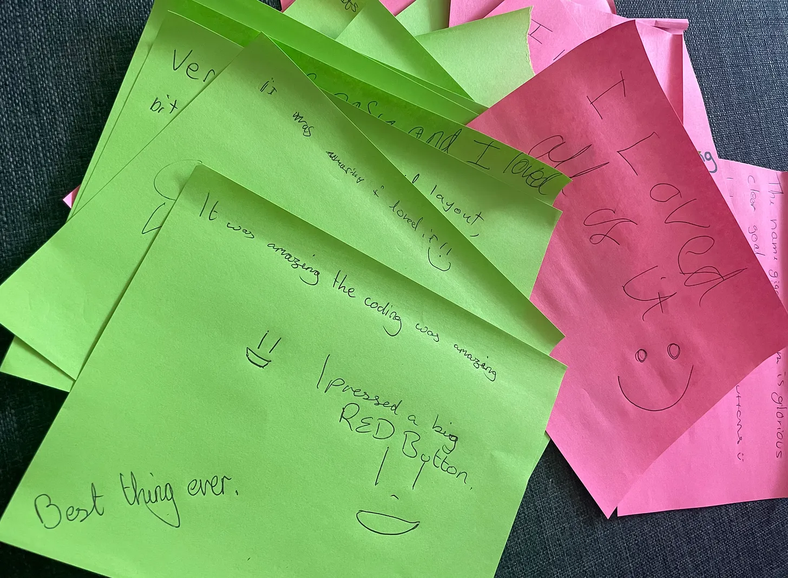
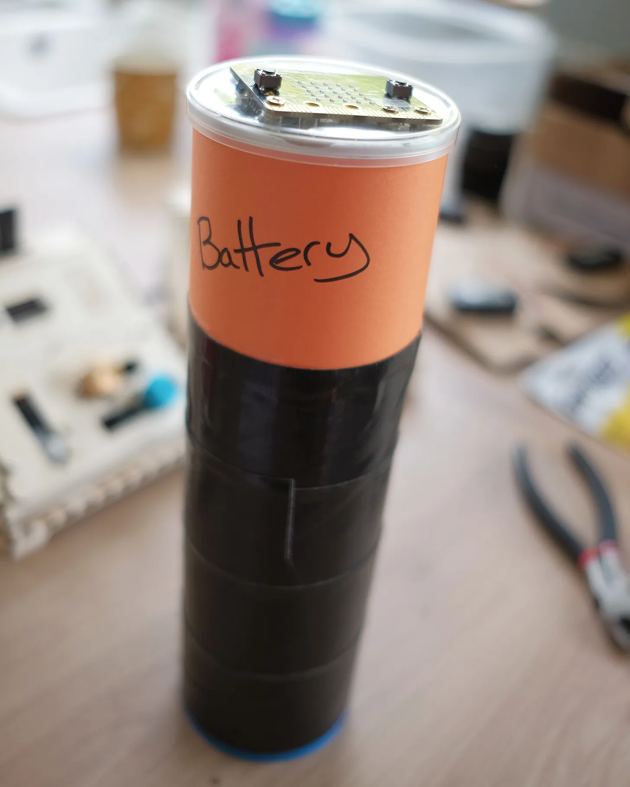
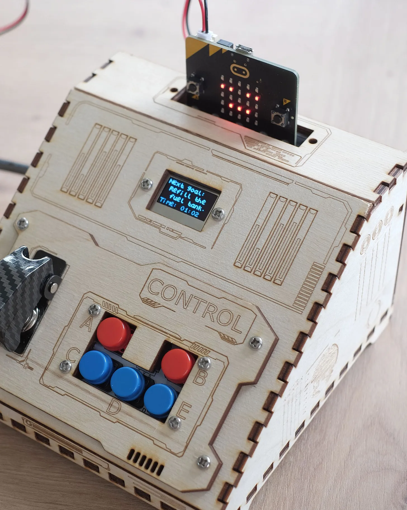
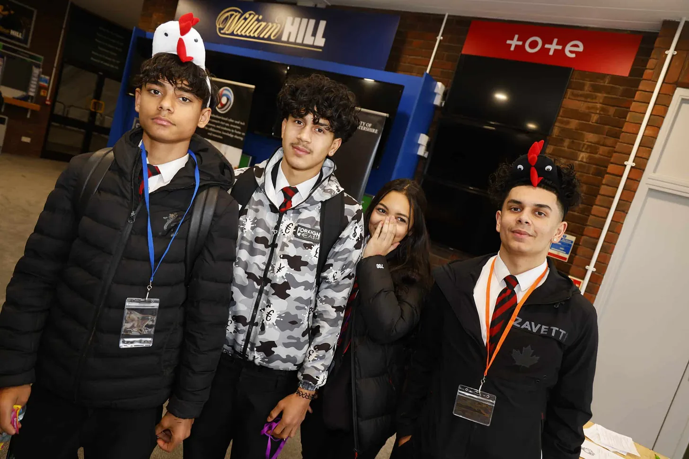
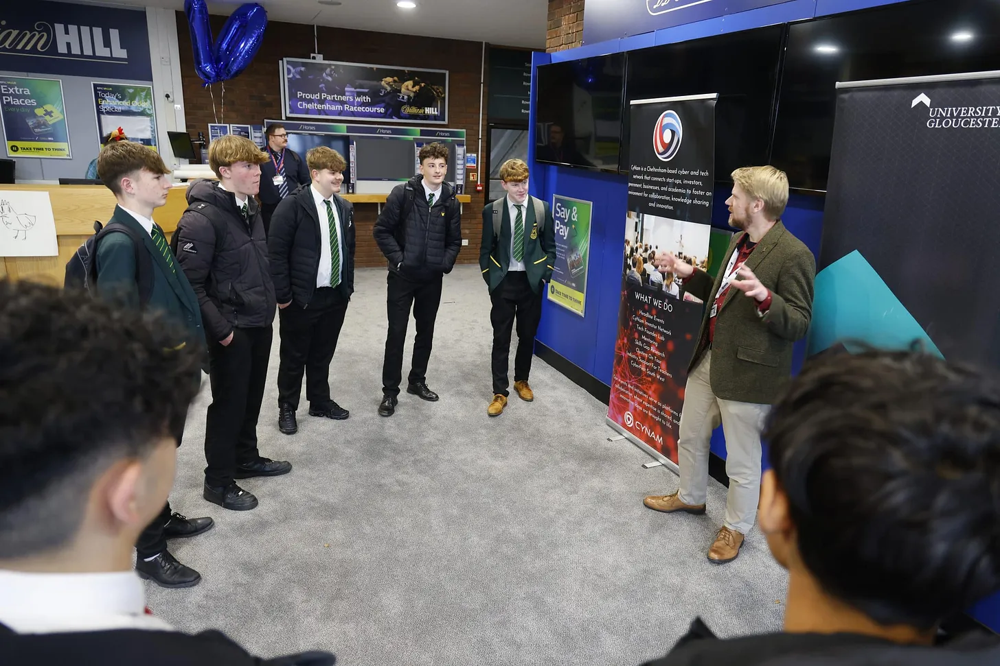
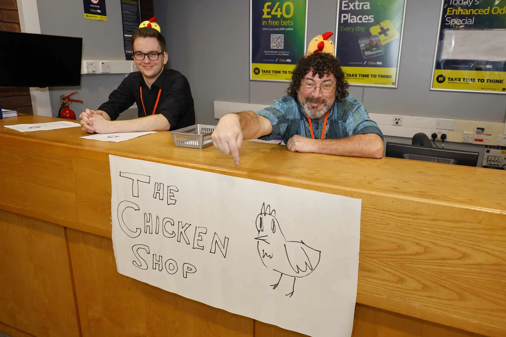

This year, I started a side project called Curious Coders, which creates resources and activities aimed at teaching kids about coding and technology.

Over the last 12 months of this project I have built and run a micro:bit based escape room for the Scouts and Guides, taught kids about cyber security through dancing like chickens (yes really!) as well as writing this newsletter and taking a first step with a YouTube channel.

As we reach the end of 2024 I wanted to take some time to review everything I’ve achieved this year, and note down a few thoughts on what's coming next year.

## Newsletter

Since starting this newsletter just over 12 months ago, I’ve put out four articles covering a range of topics. Some have been straight forward guides, like [Moving on from Scratch to Python](/articles/coding-with-python) or [Building your own escape room](/articles/build-your-own-escape-room-puzzle). The AI article, [Do our kids still need to learn to code?](/articles/do-kids-still-need-to-learn-to-code) was a little different, giving me a chance to consider the future of our industry and the huge impact AI will have over the coming years.

I've got plenty more planned for the new year, the first of which will be about OctoStudio, the new phone and tablet based coding app. It's a really fun and easy tool to use and a great way to get kids started with coding.

## YouTube - OctoStudio Tutorial

Speaking of OctoStudio, in September this year I published my first video tutorial, with help from my daughter Ellie. We used OctoStudio to build a catch game. The code was quite simple, but it was a lot of fun to build and play.

[Watch it here](https://www.youtube.com/watch?v=xFgwxr4HP6A)

Creating a video tutorial felt like quite an accomplishment, as I'd never done anything like this before. I enjoyed learning about the filming and editing process, and felt like I pushed my boundaries - talking to a camera certainly takes a bit of getting used to!

We've recorded the next tutorial, in which we made a virtual pet. I still have a few extra bits to shoot and the whole thing to edit, but hopefully this will be along soon in the new year!

## The micro:bit escape room

I've also designed and run a couple of activities this year, starting with the Space Ship Escape Room. I built this back in May/June for the Scouts and Guides Strategy weekend.

This was a great success, and I had very enthusiastic feedback from kids, leaders and parents.

Feedback for the Escape Room from the Scouts and Guides Strategy event

I set out with the goal of showing the kids how easy it is to build something like this using the micro:bit and craft materials they have around the home. I think the Pringles tube "battery" was a great example of this!

The Pringles tube battery

While I'd originally planned to build the whole thing out of cardboard, I'm really glad that my friend Adrian kindly offered to build the boxes using his laser cutter. I think the end result looks brilliant, and it's now much more reusable for further events. I've no doubt the kids would have destroyed a cardboard version in a few hours, they do hit the big red button very enthusiastically!

One of the laser cut consoles

The code and designs are all open source, and you can find them [here](https://github.com/brggs/Fix-The-SpaceShip-Escape-Room) on github.

I've since run the activity again for our [code club](https://bccd.uk/), another Scout group and for my family. It's always great fun to watch people solving the puzzles, and the different ways each team approaches things. Some are cautious and take time to explore, while others jump straight into it and whack the red button to start the game the instant they walk into the room!

Next year I hope to run the activity again. It took a lot of time to build (and a few late nights getting it finished!) so it would be great to get as much use out of it as possible.

I've also had quite a few requests to turn this into a product. This would be quite a bit of work, but I like the idea of creating something reusable which could be used for multiple escape room scenarios. Kickstarter could be a good option here - something to look into in the new year!

## Social Engineering Activity: Chicken Shop

In November this year I ran an activity at the cyber security outreach event EmPower - part of the [NCSCs CyberFirst programme](https://www.gchq-careers.co.uk/cyberfirst.html). This challenged teams to steal the secret recipe from a chicken shop by posing as employees, and saw hundreds of Year 9's dancing like chickens in the process!

Testing physical security in this way is a real job in cyber security, and the concepts also map closely to protecting against online scams like phishing. This sort of thing is sadly very common these days, so it was useful to raise the kids’ awareness whilst showing them how it could also be a future career.

Through the activity, the kids learned about how a company's security can be compromised by what they share online, and how technology can be bypassed if you're able to convince people to reveal their secrets! This human side of cyber security is often overlooked in outreach activities, so it was great to be able to show the kids that there is more to this profession than coding and technical roles.

If I'm honest, I had some doubts about how well the activity would be received in the run up to the event. It all sounded a bit mad, and I wasn't sure whether the kids would get it. I needn't have worried though - the kids threw themselves into the challenge and there was a real buzz of creativity and excitement throughout the day.

The teams embraced the creative and social aspects of the task, some staging elaborate distractions to allow them to steal company secrets (one girl performed CPR on a toy duck!). Others put lots of effort into forging their company ID photo. One team even realised they could turn the rules against us, and make our volunteers do the chicken dance on repeat!

In the end it was a great success and we had lovely feedback, in no small part thanks to the brilliant volunteers who played the role of the real chicken shop employees. Huge thanks to Mark from [CyNam](https://www.cynam.org/), Gareth and Joe from the [University of Gloucestershire](https://www.glos.ac.uk/) and Amy B!

## What's coming in 2025?

After all that, I'm certainly looking forward to a break this Christmas!

In 2025 I’m looking forward to making more videos for YouTube. As well as continuing the OctoStudio tutorials, I’ll be putting together a video about the Chicken Shop activity, explaining the cyber security lessons and how kids can stay safe online.

I'd also like to further explore the idea of teaching tech subjects away from the computer screen. I have some more ideas for “offline” activities, looking at subjects such as AI.

However, I do need to remember that this is a part time project, so I really need to focus my efforts and consider how I can have the most impact with limited time. I think in 2025 I will need to be more selective about what I take on, rather than saying yes to everything that sounds fun!

## Thank You!

The only thing that remains is to say a massive thank you to everyone who’s supported me this year - subscribing to the newsletter or YouTube, helping out with activities or offered words of encouragement. It’s all hugely appreciated!

Wishing you all a very Merry Christmas, and a happy new year - all the best for your 2025!

- Andy