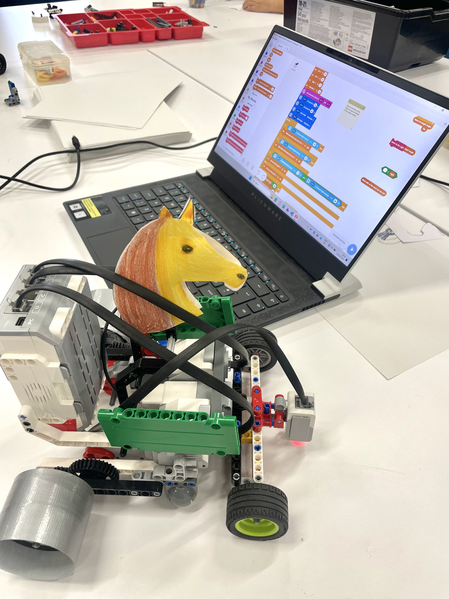
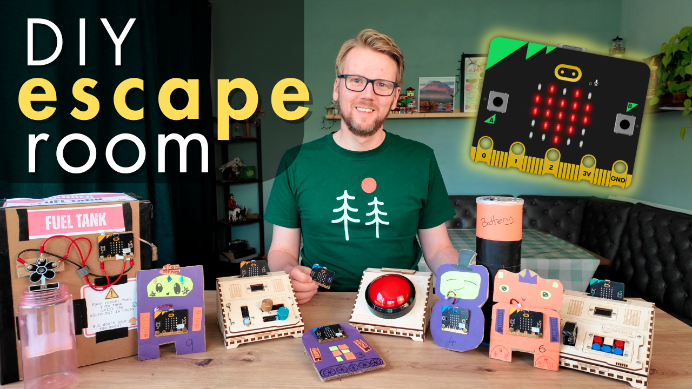
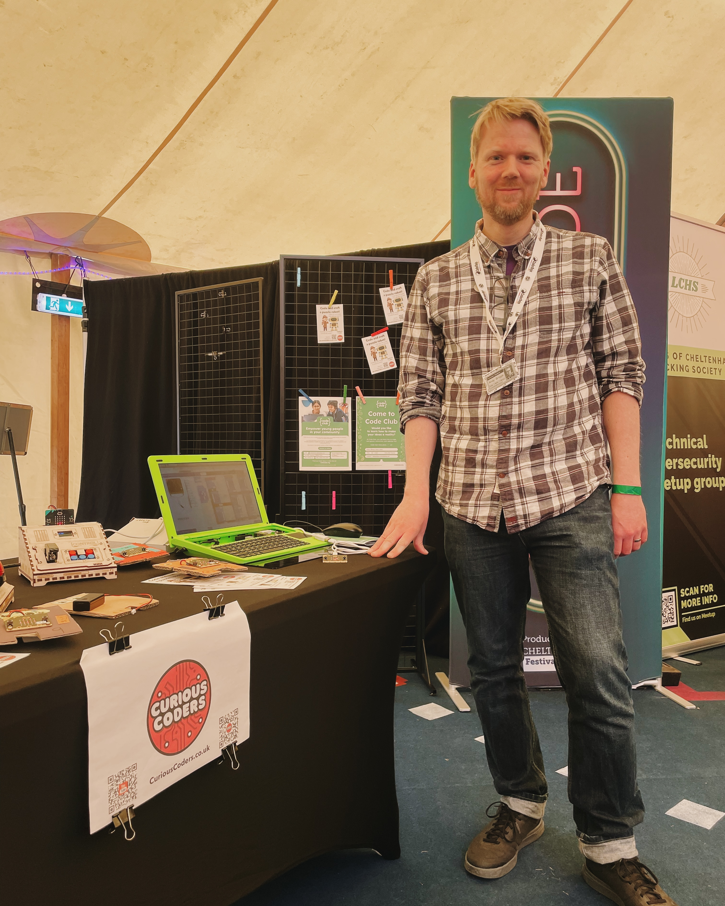
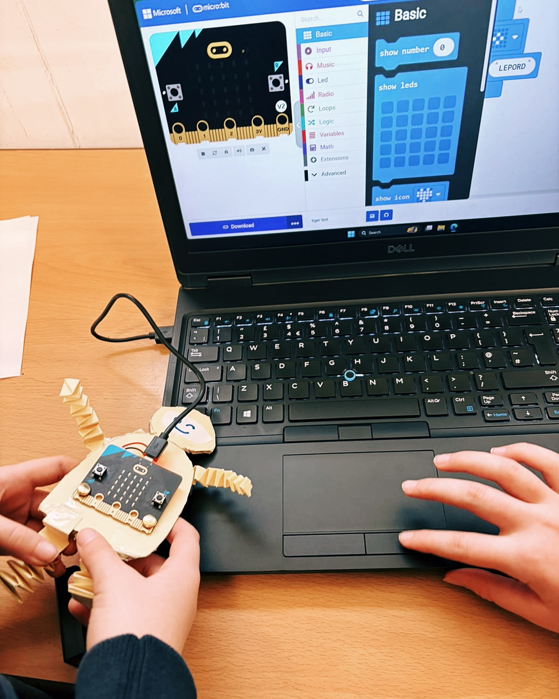
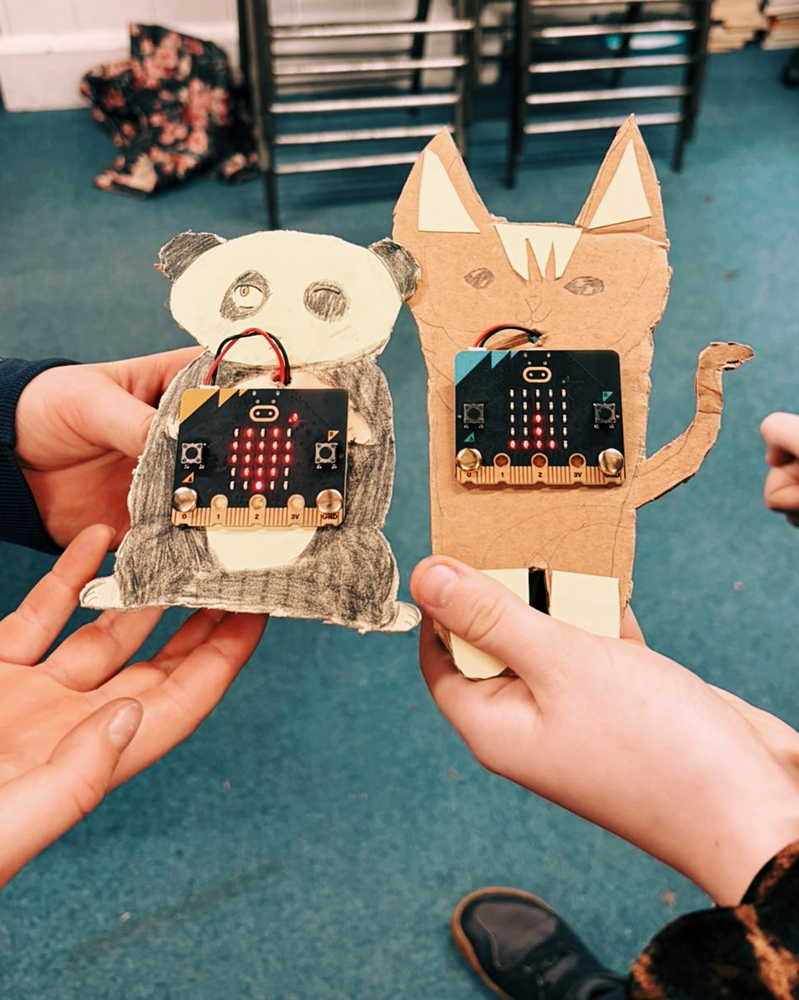
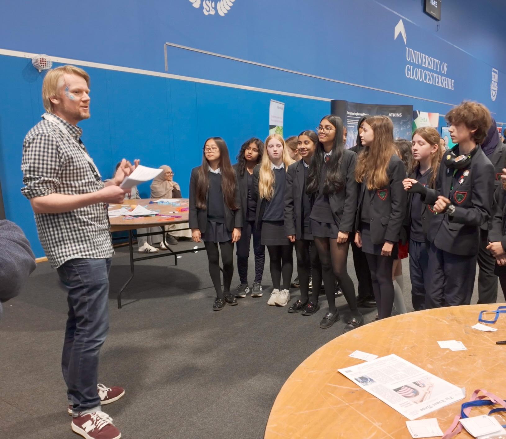
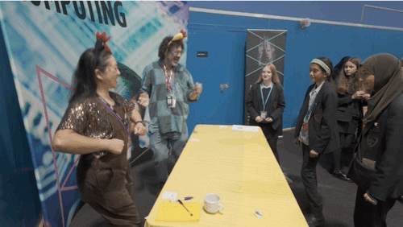
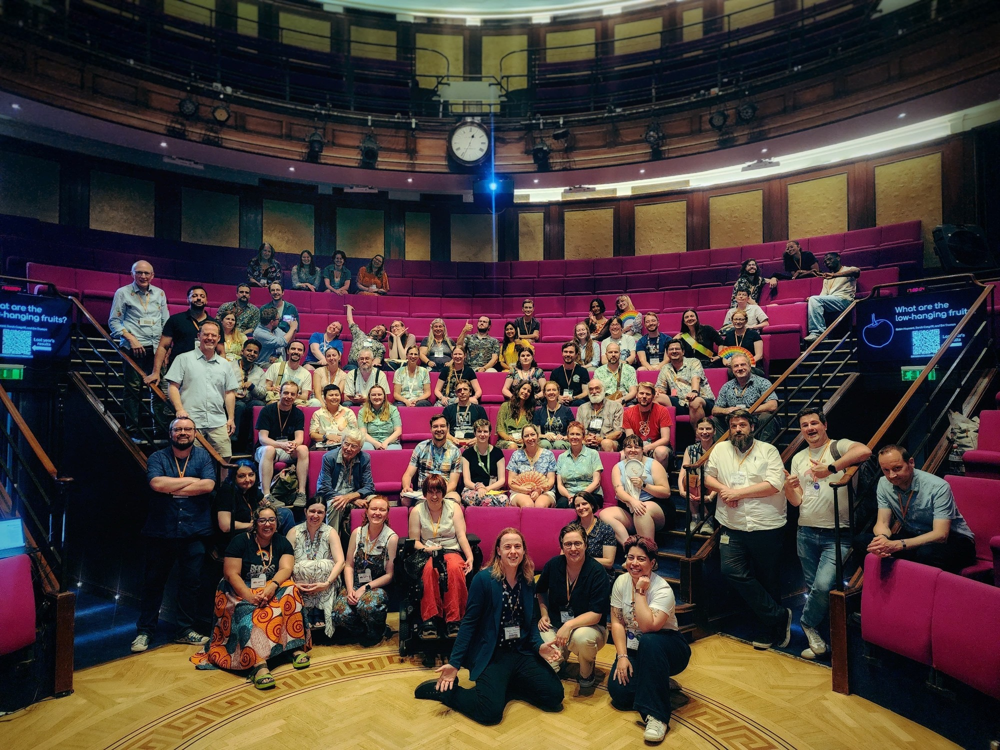
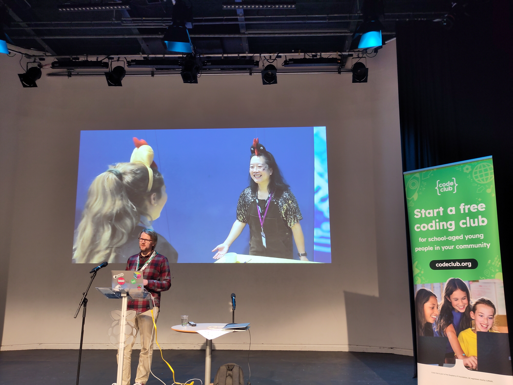

2025 was a busy year for me and my Curious Coders side project.  While I didn’t manage to post any updates on the newsletter throughout the year, I thought I’d do a quick recap now before we get too far into 2026!

Before I get started though, I have lots of ideas about what Curious Coders could get up to this coming year.  If you'd like to get involved, or have any ideas for events or activities, please give me a shout - I'd love to work together!

## Code Club

Our [Code Club in Bishops Cleeve Library](https://bccd.uk/) has had another strong year, celebrating our third birthday in September.  We've had good attendance throughout, averaging 10+ kids per week. We also welcomed some new volunteers in the last few months who will be a massive help in keeping things running.  The kids worked on all sorts of projects, including these lego racing horses which the kids made for the library's summer challenge.

A Lego "racehorse"

## The Escape Room

I ran the [micro:bit escape room activity](https://github.com/brggs/Fix-The-SpaceShip-Escape-Room) again, this year for a slightly younger age group - the Brownies and Cubs at the [Evolution camp](https://s-e.org.uk).  This was just as much fun as the previous year and again kept me busy for the whole day!

I did manage to find time to video some of the team's attempts though, and used this to create a video for YouTube showing off how the activity works.  This was the first video I've made which isn't a tutorial, and I'm really pleased with how it came out.  You can watch it [here](https://youtu.be/0pUaQZcnjMQ).

## Science Festival

Cheltenham Science Festival very kindly offered me a spot in the Arcade tent at the 2025 festival.  This was a great opportunity to recruit new members and volunteers for our code club, and I also brought along the micro:bit robots from the first part of the escape room as a mini challenge for the kids.

I also supported the festival with their [FameLab Academy](https://www.cheltenhamfestivals.org/our-projects/famelab/famelab-academy-uk) competition as a STEM mentor.  The year 9 kids taking part write and deliver a 3-minute talk on a STEM topic of their choice.  I helped out at a Gloucester school by providing advice for the kids as they worked on their speech, then joined them as a judge for their school final.

The standard was really high (way better than anything I could have achieved at that age!), and I was really pleased that the winner from the school I supported went on to be a runner-up in the overall final, with an excellent talk about how general relativity and time dilation are his excuse for being late for school in the morning!

## Robot Activity

In preparation for the Science Festival, I developed an activity based on the puzzle robots. This gives kids the chance to design their own cardboard robot, and code a puzzle to challenge their friends. The instructions are [here](/articles/code-and-craft-puzzle-robot) if you'd like to have a go!

In November I did a trial run of this activity with years 3-6 at a school in Stroud.  I was really impressed with their creativity, and came away with a lot of improvements to make to the lesson run more smoothly!

Here are some of their creations:

## Chicken Dances 

In October I returned to the fantastic CyberFirst EmPower event, to do a re-run of the Chicken Shop activity.  This teaches kids in years 8 and 9 about social engineering and the human side of cyber security, by challenging them to steal the secret recipe from our pretend chicken shop! The stall is staffed by our wonderful volunteers who play the part of the real employees.  The kids must research the company, then dress like a real employee and show off their insider knowledge in order to convince the volunteers to hand over the recipe.

The final challenge for the kids, to prove they really do work for the chicken shop, is to dance like a chicken!  It's all a great laugh until they realise they can turn the rules of the game back on to us and make us dance as well!

## Conferences

This year I had the chance to speak at a couple of conferences about these activites.

I showed off the micro:bit escape room at the [BIG Conference for STEM Communicators](https://www.big.uk.com).  I had an amazing time there, meeting so many inspiring and talented folk, but it was also awesome just to be in the Royal Instution!

The BIG Conference attendees at the Royal Institution

In Novemeber I went back to Cambridge for the Raspberry Pi Clubs Conference, which brings together people running code clubs around the world, along with the Raspberry Pi Foundation staff who provide loads of resources and support to us all.

I talked about the Chicken Shop activity, and the wider theme of teaching tech and computing concepts away from the computer screen.

You can watch this talk as part of the livestream recording [here](https://www.youtube.com/live/3dwzJim0AzI?t=1568s).

## 2026

My first goal in the new year is to produce a video for the Curious Coders YouTube channel about the Chicken Shop activity, and the cyber security lessons it teaches.

After that, I'd like to work on making something new - possibly a brand new micro:bit based escape room.  I have some ideas for the theme here, leaving the spaceship behind and heading back to the Victorian era!

And of course I'll be continuing with the Code Club throughout the year, which will be a great place to test out these ideas!

If any of these ideas interest you, or if you have suggestions, please do [get in touch](mailto:andy@curiouscoders.co.uk) - it would be great to work together!

And to finish, once again I'd like to say a massive thank you to everyone who’s supported and encouraged me this year.  It's been great to have such wonderful feedback, particularly on the Escape Room YouTube video, and it wouldn't have been possible without all the kind folk who've helped me out at the events and behind the scenes.  It’s all very much appreciated!

Wishing you all a fun and productive 2026!

- Andy